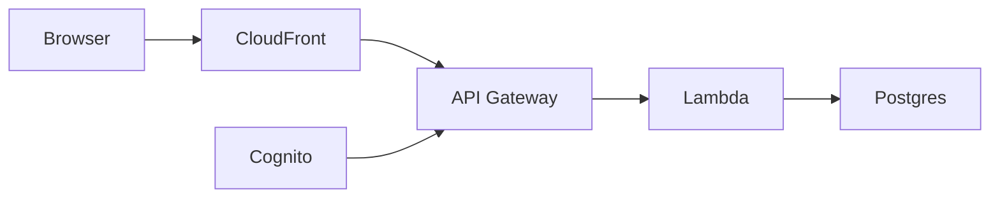
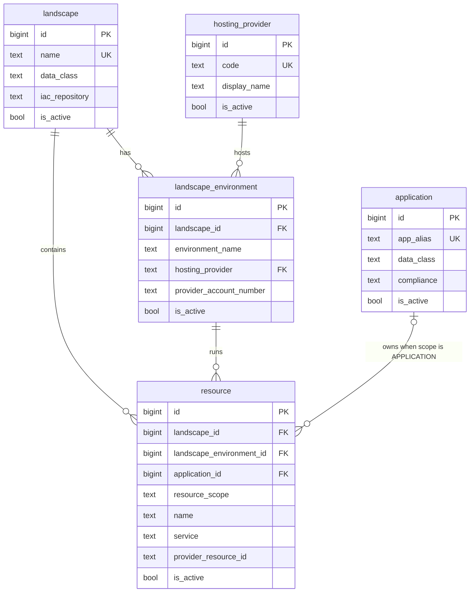

# easyCMDB API

HTTP API for [easyCMDB](https://github.com/karlamber/easycmdb-web), a configuration inventory of applications, landscapes, environments, and resources. The UI is a separate repository. This one is the service behind it: a single TypeScript Lambda, API Gateway, and Postgres.

The product name is easyCMDB. The technical alias `argus` remains in the Postgres schema, default role-claim prefixes, and audit columns.

## Architecture

The code is a hexagonal layout, and `dependency-cruiser` enforces the layer rules when you run `npm run lint:arch`. Interfaces and infrastructure may depend on application and domain, while domain stays free of AWS and of the database driver, which is what keeps a use case testable without standing up Lambda. The three files that show the shape are `src/handler.ts`, where the composition root wires dependencies, `src/interfaces/http/api-router.ts`, where a request becomes a use case, and any one repository under `src/infrastructure/repositories/`.

```
interfaces  ─┐
             ├─▶ application ─▶ domain
infrastructure ──────────────▶ domain
```



| Layer            | Folder                 | Contains                                                           |
| ---------------- | ---------------------- | ------------------------------------------------------------------ |
| Composition root | `src/handler.ts`       | Lambda entrypoint, dependency wiring, top-level catch              |
| Config           | `src/config.ts`        | Zod-validated env parsing. The only place that reads `process.env` |
| Interfaces       | `src/interfaces/http/` | API Gateway v1 and v2 normalization, router, CORS, auth, schemas   |
| Application      | `src/application/`     | Use cases (`*CrudService`)                                         |
| Domain           | `src/domain/`          | Entities, repository ports, `DomainError` hierarchy                |
| Infrastructure   | `src/infrastructure/`  | `pg` pool and `Pg*Repository` adapters                             |
| Observability    | `src/observability/`   | Structured JSON logger                                             |

## Data model

Five tables in the `argus` schema hold the inventory, and `schema_migrations` is bookkeeping for `scripts/migrate.mjs` rather than part of that inventory.



A resource’s environment must belong to the same landscape. That is a composite foreign key on `(landscape_environment_id, landscape_id)`. `application_id` is required when `resource_scope` is `APPLICATION` and must be null when the scope is `ENVIRONMENT`. Deletes are soft: `is_active` flips to false, and `deleted_by` records the principal. `hosting_provider.code` is immutable because environments reference it.

## HTTP API

Every route except `GET /health` and `OPTIONS *` requires auth. An optional `/api` prefix is stripped before routing.

| Method | Path                           | Auth    | Description                                                  |
| ------ | ------------------------------ | ------- | ------------------------------------------------------------ |
| GET    | `/health`                      | none    | Liveness probe                                               |
| GET    | `/me`                          | viewer+ | Caller identity and role                                     |
| GET    | `/applications`                | viewer+ | List applications                                            |
| GET    | `/applications/{id}`           | viewer+ | Fetch one                                                    |
| POST   | `/applications`                | admin   | Create                                                       |
| PATCH  | `/applications/{id}`           | admin   | Update                                                       |
| DELETE | `/applications/{id}`           | admin   | Soft-delete                                                  |
| GET    | `/landscapes`                  | viewer+ | List landscapes                                              |
| GET    | `/landscapes/{id}`             | viewer+ | Fetch one                                                    |
| POST   | `/landscapes`                  | admin   | Create                                                       |
| PATCH  | `/landscapes/{id}`             | admin   | Update                                                       |
| DELETE | `/landscapes/{id}`             | admin   | Soft-delete                                                  |
| GET    | `/landscape-environments`      | viewer+ | List, optional `?landscape_id=`                              |
| GET    | `/landscape-environments/{id}` | viewer+ | Fetch one                                                    |
| POST   | `/landscape-environments`      | admin   | Create                                                       |
| PATCH  | `/landscape-environments/{id}` | admin   | Update                                                       |
| DELETE | `/landscape-environments/{id}` | admin   | Soft-delete                                                  |
| GET    | `/resources`                   | viewer+ | List, filter by landscape, environment, or application       |
| GET    | `/resources/{id}`              | viewer+ | Fetch one                                                    |
| POST   | `/resources`                   | admin   | Create                                                       |
| PATCH  | `/resources/{id}`              | admin   | Update                                                       |
| DELETE | `/resources/{id}`              | admin   | Soft-delete                                                  |
| GET    | `/hosting-providers`           | viewer+ | List hosting providers                                       |
| GET    | `/hosting-providers/{id}`      | viewer+ | Fetch one                                                    |
| POST   | `/hosting-providers`           | admin   | Create                                                       |
| PATCH  | `/hosting-providers/{id}`      | admin   | Update display fields. Code is immutable                     |
| DELETE | `/hosting-providers/{id}`      | admin   | Soft-delete. 409 if an environment still references the code |

### Auth

`AUTH_MODE` selects what the Lambda accepts:

| Mode              | Accepts                                                   |
| ----------------- | --------------------------------------------------------- |
| `basic` (default) | HTTP Basic only                                           |
| `cognito`         | Cognito JWT claims forwarded by an API Gateway authorizer |
| `both`            | Either method                                             |

Align this with the SPA's `VITE_AUTH_MODE`.

Basic auth has two tiers, both taken from environment variables. `BASIC_AUTH_USER` and `BASIC_AUTH_PASSWORD` are the viewer, who can read, and `BASIC_AUTH_ADMIN_USER` and `BASIC_AUTH_ADMIN_PASSWORD` are the admin, who can read and write. A write from a viewer returns `403` with code `INSUFFICIENT_ROLE`. Password comparison uses `crypto.timingSafeEqual`, so the check does not leak the secret through timing.

A `ZodError` becomes `400` with `{ error: 'Invalid request', details }`. A `DomainError` keeps its `statusCode` and returns `{ error, code }`, which is how `NOT_FOUND` is 404, `CONFLICT` is 409, `VALIDATION_ERROR` is 400, and `UNAUTHORIZED` is 401. Anything else becomes `500 { error }` and is logged as `handler.unhandled_error`. Audit columns (`created_by`, `updated_by`, `deleted_by`) are set from the authenticated principal, and clients cannot send them.

## Local development

Node 24 (`.nvmrc`), npm. Postgres 17 comes from Docker Compose. Colima (or another engine) has to be running so `docker compose` can reach a daemon.

```bash
npm ci
cp .env.example .env.local
docker compose up -d
psql -h 127.0.0.1 -U easycmdb -d easycmdb -f db/bootstrap.sql
psql -h 127.0.0.1 -U easycmdb -d easycmdb -f db/seed.sql
npm run dev
```

`npm run dev` listens on `http://127.0.0.1:3000` and calls the same Lambda handler the cloud function uses. `GET /api/health` is anonymous. Sign in as `admin` / `admin` for Management, or `viewer` / `viewer` for read-only Discover. `db/seed.sql` loads a small demo inventory. If port 5432 is already in use, change the host port in `docker-compose.yml` and `PGPORT` in `.env.local` together.

Then start [easycmdb-web](https://github.com/karlamber/easycmdb-web) with `VITE_AUTH_MODE=basic`.

```bash
npm run typecheck
npm run lint:arch
npm test
npm run build
```

`npm run lint` runs ESLint with `--fix`. CI runs ESLint without fixing. Husky runs lint-staged on commit and the quality gate on push.

Configuration is parsed in `src/config.ts`.

| Variable                     | Required | Default        | Notes                                                            |
| ---------------------------- | -------- | -------------- | ---------------------------------------------------------------- |
| `PGHOST`                     | yes      | —              | Postgres host                                                    |
| `PGPORT`                     | no       | `5432`         |                                                                  |
| `PGUSER`                     | yes      | —              |                                                                  |
| `PGPASSWORD`                 | yes      | —              |                                                                  |
| `PGDATABASE`                 | yes      | —              |                                                                  |
| `PG_SSL`                     | no       | `false`        | `"true"` to enable TLS                                           |
| `PG_SSL_REJECT_UNAUTHORIZED` | no       | `true`         | `"false"` for some RDS CA setups. The connection stays encrypted |
| `BASIC_AUTH_USER`            | yes      | —              | Viewer username                                                  |
| `BASIC_AUTH_PASSWORD`        | yes      | —              | Viewer password                                                  |
| `BASIC_AUTH_ADMIN_USER`      | no       | —              | Admin username                                                   |
| `BASIC_AUTH_ADMIN_PASSWORD`  | no       | —              | Admin password                                                   |
| `CORS_ORIGIN`                | no       | —              | Comma-separated origins, or `*`                                  |
| `LOG_LEVEL`                  | no       | `info`         | `trace` through `fatal`                                          |
| `SERVICE_NAME`               | no       | `easycmdb-api` | Embedded in every log line                                       |
| `ENV_NAME`                   | no       | `local`        | Embedded in every log line                                       |
| `AUTH_MODE`                  | no       | `basic`        | `basic`, `cognito`, or `both`                                    |

## Database

The [data model](#data-model) above is the end state.

### New database

`db/bootstrap.sql` creates the `argus` schema, the five tables, the hosting-provider seed rows, and the migration stamps. After it runs, `npm run migrate` has nothing pending.

```bash
createdb easycmdb
psql -d easycmdb -f db/bootstrap.sql
```

Point the API at that database with `PGHOST`, `PGUSER`, `PGPASSWORD`, and `PGDATABASE`. The script does not create a login role. On Aurora, the landscape `initial-config.sql` adds the `argus_lambda` role and grants. A commented copy of that block is at the bottom of `db/bootstrap.sql`.

### Existing database

Schema changes live in `db/migrations/` as plain SQL, applied in lexical order by `scripts/migrate.mjs`. Applied versions are recorded in `argus.schema_migrations`.

Migrations are a separate step from deploying the function. Apply SQL before deploying code that reads or writes the new shape, because the Lambda process does not run DDL. Write an additive migration, using `IF NOT EXISTS` and `ADD COLUMN IF NOT EXISTS`, so the previous version of the function still runs after the SQL applies. On the target database, apply the SQL and then deploy the Lambda, and promote that pair through dev, then test, then prod, so code never requires a column the database does not have yet. Drops, renames, and `NOT NULL` without a default wait for a later migration, after every environment is running code that no longer needs the old shape.

```bash
export PGHOST=... PGUSER=... PGPASSWORD=... PGDATABASE=...
npm run migrate:status
npm run migrate
```

`npm run migrate:stamps` prints the version rows to keep in `db/bootstrap.sql` and in each landscape `initial-config.sql`. `npm run migrate:check-bootstrap` checks those files:

```bash
npm run migrate:check-bootstrap -- db/bootstrap.sql
```

## Deploy

`npm run build` emits one esbuild bundle, `dist/handler.js`, targeted at Node 24.

`scripts/deploy-poc.mjs` uploads that zip to an S3 bucket and calls `lambda:UpdateFunctionCode`. Copy `.env.deploy.example` to a gitignored env file and point it at your own account. VPC, Aurora, API Gateway, Cognito, and IAM live outside this repository.

## Observability

Each invocation logs JSON lines: `request.received`, `request.completed` (status and duration), plus auth, validation, domain, and unhandled-error events. The request logger carries `requestId`, `sourceIp`, `method`, and `path`.

## License

[MIT](LICENSE)
