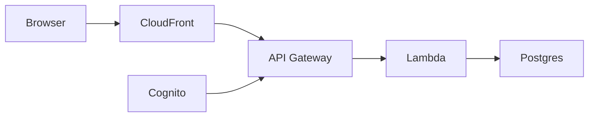
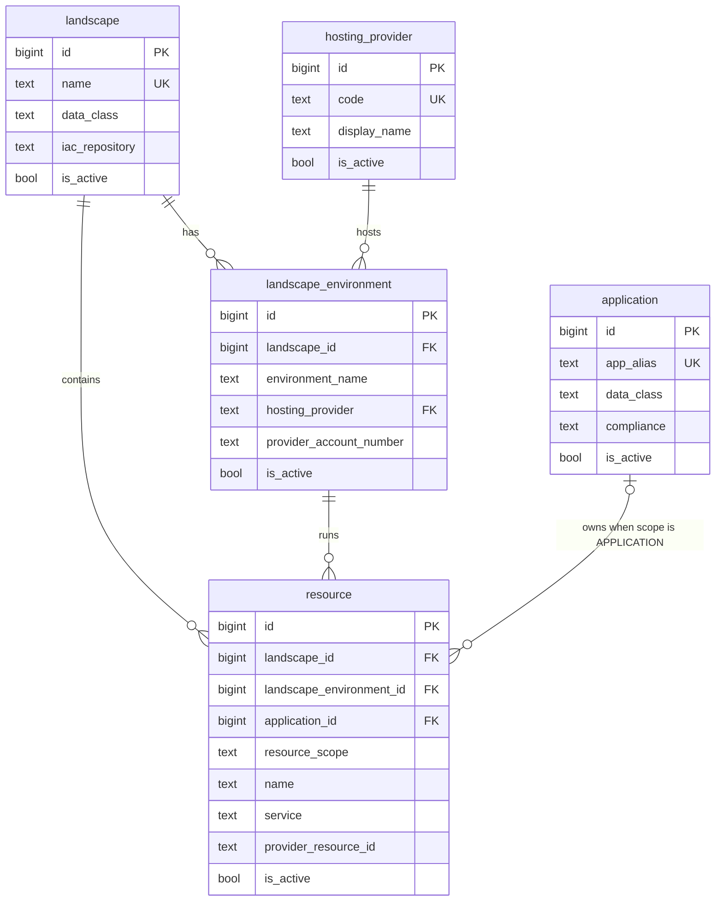

# easyCMDB API

HTTP API for [easyCMDB](https://github.com/karlamber/easycmdb-web), a configuration inventory of applications, landscapes, environments, and resources. The UI is a separate repository. This one is the service behind it: a single TypeScript Lambda, API Gateway, and Postgres.

The product name is easyCMDB. The technical alias `argus` remains in the Postgres schema, default role-claim prefixes, and audit columns.

## Architecture

Hexagonal layout. `dependency-cruiser` enforces the layer rules (`npm run lint:arch`).

```
interfaces  ─┐
             ├─▶ application ─▶ domain
infrastructure ──────────────▶ domain
```



| Layer            | Folder                 | Contains                                                           |
| ---------------- | ---------------------- | ------------------------------------------------------------------ |
| Composition root | `src/handler.ts`       | Lambda entrypoint, dependency wiring, top-level catch              |
| Config           | `src/config.ts`        | Zod-validated env parsing. The only place that reads `process.env` |
| Interfaces       | `src/interfaces/http/` | API Gateway v1 and v2 normalization, router, CORS, auth, schemas   |
| Application      | `src/application/`     | Use cases (`*CrudService`)                                         |
| Domain           | `src/domain/`          | Entities, repository ports, `DomainError` hierarchy                |
| Infrastructure   | `src/infrastructure/`  | `pg` pool and `Pg*Repository` adapters                             |
| Observability    | `src/observability/`   | Structured JSON logger                                             |

If you read three files: `src/handler.ts`, `src/interfaces/http/api-router.ts`, and one repository under `src/infrastructure/repositories/`.

## Data model

Five tables in the `argus` schema. `schema_migrations` is bookkeeping for `scripts/migrate.mjs` and is not part of the inventory.



A resource’s environment must belong to the same landscape. That is a composite foreign key on `(landscape_environment_id, landscape_id)`. `application_id` is required when `resource_scope` is `APPLICATION` and must be null when the scope is `ENVIRONMENT`. Deletes are soft: `is_active` flips to false, and `deleted_by` records the principal. `hosting_provider.code` is immutable because environments reference it.

## HTTP API

Every route except `GET /health` and `OPTIONS *` requires auth. An optional `/api` prefix is stripped before routing.

| Method | Path                           | Auth    | Description                                                  |
| ------ | ------------------------------ | ------- | ------------------------------------------------------------ |
| GET    | `/health`                      | none    | Liveness probe                                               |
| GET    | `/me`                          | viewer+ | Caller identity and role                                     |
| GET    | `/applications`                | viewer+ | List applications                                            |
| GET    | `/applications/{id}`           | viewer+ | Fetch one                                                    |
| POST   | `/applications`                | admin   | Create                                                       |
| PATCH  | `/applications/{id}`           | admin   | Update                                                       |
| DELETE | `/applications/{id}`           | admin   | Soft-delete                                                  |
| GET    | `/landscapes`                  | viewer+ | List landscapes                                              |
| GET    | `/landscapes/{id}`             | viewer+ | Fetch one                                                    |
| POST   | `/landscapes`                  | admin   | Create                                                       |
| PATCH  | `/landscapes/{id}`             | admin   | Update                                                       |
| DELETE | `/landscapes/{id}`             | admin   | Soft-delete                                                  |
| GET    | `/landscape-environments`      | viewer+ | List, optional `?landscape_id=`                              |
| GET    | `/landscape-environments/{id}` | viewer+ | Fetch one                                                    |
| POST   | `/landscape-environments`      | admin   | Create                                                       |
| PATCH  | `/landscape-environments/{id}` | admin   | Update                                                       |
| DELETE | `/landscape-environments/{id}` | admin   | Soft-delete                                                  |
| GET    | `/resources`                   | viewer+ | List, filter by landscape, environment, or application       |
| GET    | `/resources/{id}`              | viewer+ | Fetch one                                                    |
| POST   | `/resources`                   | admin   | Create                                                       |
| PATCH  | `/resources/{id}`              | admin   | Update                                                       |
| DELETE | `/resources/{id}`              | admin   | Soft-delete                                                  |
| GET    | `/hosting-providers`           | viewer+ | List hosting providers                                       |
| GET    | `/hosting-providers/{id}`      | viewer+ | Fetch one                                                    |
| POST   | `/hosting-providers`           | admin   | Create                                                       |
| PATCH  | `/hosting-providers/{id}`      | admin   | Update display fields. Code is immutable                     |
| DELETE | `/hosting-providers/{id}`      | admin   | Soft-delete. 409 if an environment still references the code |

### Auth

`AUTH_MODE` selects what the Lambda accepts:

| Mode              | Accepts                                                   |
| ----------------- | --------------------------------------------------------- |
| `basic` (default) | HTTP Basic only                                           |
| `cognito`         | Cognito JWT claims forwarded by an API Gateway authorizer |
| `both`            | Either method                                             |

Align this with the SPA's `VITE_AUTH_MODE`.

Basic auth has two tiers, both from environment variables:

- `BASIC_AUTH_USER` / `BASIC_AUTH_PASSWORD` — viewer, read-only
- `BASIC_AUTH_ADMIN_USER` / `BASIC_AUTH_ADMIN_PASSWORD` — admin, read and write

Writes return `403` with code `INSUFFICIENT_ROLE` for viewers. Password comparison uses `crypto.timingSafeEqual`.

### Errors

- `ZodError` → `400 { error: 'Invalid request', details }`
- `DomainError` → its `statusCode` plus `{ error, code }` (`NOT_FOUND` 404, `CONFLICT` 409, `VALIDATION_ERROR` 400, `UNAUTHORIZED` 401)
- Anything else → `500 { error }`, logged as `handler.unhandled_error`

Audit columns (`created_by`, `updated_by`, `deleted_by`) are set from the authenticated principal. Clients cannot send them.

## Local development

Node 24 (`.nvmrc`), npm.

```bash
npm ci
npm run typecheck
npm run lint:arch
npm test
npm run build
```

`npm run lint` runs ESLint with `--fix`. CI runs ESLint without fixing. Husky runs lint-staged on commit and the quality gate on push.

Configuration is parsed in `src/config.ts`.

| Variable                     | Required | Default        | Notes                                                            |
| ---------------------------- | -------- | -------------- | ---------------------------------------------------------------- |
| `PGHOST`                     | yes      | —              | Postgres host                                                    |
| `PGPORT`                     | no       | `5432`         |                                                                  |
| `PGUSER`                     | yes      | —              |                                                                  |
| `PGPASSWORD`                 | yes      | —              |                                                                  |
| `PGDATABASE`                 | yes      | —              |                                                                  |
| `PG_SSL`                     | no       | `false`        | `"true"` to enable TLS                                           |
| `PG_SSL_REJECT_UNAUTHORIZED` | no       | `true`         | `"false"` for some RDS CA setups. The connection stays encrypted |
| `BASIC_AUTH_USER`            | yes      | —              | Viewer username                                                  |
| `BASIC_AUTH_PASSWORD`        | yes      | —              | Viewer password                                                  |
| `BASIC_AUTH_ADMIN_USER`      | no       | —              | Admin username                                                   |
| `BASIC_AUTH_ADMIN_PASSWORD`  | no       | —              | Admin password                                                   |
| `CORS_ORIGIN`                | no       | —              | Comma-separated origins, or `*`                                  |
| `LOG_LEVEL`                  | no       | `info`         | `trace` through `fatal`                                          |
| `SERVICE_NAME`               | no       | `easycmdb-api` | Embedded in every log line                                       |
| `ENV_NAME`                   | no       | `local`        | Embedded in every log line                                       |
| `AUTH_MODE`                  | no       | `basic`        | `basic`, `cognito`, or `both`                                    |

## Database

The [data model](#data-model) above is the end state. Schema changes live in `db/migrations/` as plain SQL, applied in lexical order by `scripts/migrate.mjs`. Applied versions are recorded in `argus.schema_migrations`.

Migrations are a separate step from deploying the function. Apply SQL before deploying code that reads or writes the new shape. The Lambda process does not run DDL.

1. Write an additive migration (`IF NOT EXISTS`, `ADD COLUMN IF NOT EXISTS`). Old code must still run after it applies.
2. On the target database, apply SQL, then deploy the Lambda.
3. Promote dev, then test, then prod. Do not deploy code that requires a column the database does not have yet.
4. Drops, renames, and `NOT NULL` without a default are a later migration, after every environment runs code that no longer needs the old shape.

```bash
export PGHOST=... PGUSER=... PGPASSWORD=... PGDATABASE=...
npm run migrate:status
npm run migrate
```

A brand-new database can be bootstrapped from a snapshot that matches the migration end state. `npm run migrate:stamps` prints the version rows to record in that snapshot. `npm run migrate:check-bootstrap` checks a snapshot file you pass on the command line. Those snapshots are operational and are not part of this repository.

## Deploy

`npm run build` emits one esbuild bundle, `dist/handler.js`, targeted at Node 24.

`scripts/deploy-poc.mjs` uploads that zip to an S3 bucket and calls `lambda:UpdateFunctionCode`. Copy `.env.deploy.example` to a gitignored env file and point it at your own account. VPC, Aurora, API Gateway, Cognito, and IAM live outside this repository.

## Observability

Each invocation logs JSON lines: `request.received`, `request.completed` (status and duration), plus auth, validation, domain, and unhandled-error events. The request logger carries `requestId`, `sourceIp`, `method`, and `path`.

## License

[MIT](LICENSE)
